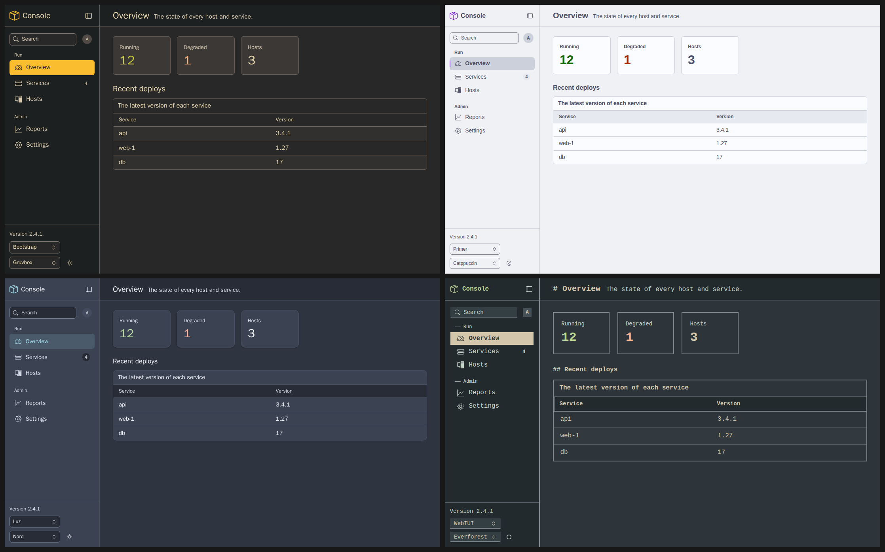

# tailor



Tailor is a UI framework: standard shells and standard components, swappable skins and palettes, for React
and for plain HTML. A UI built from it is right the first time, in every skin and palette, on a desktop and
on a phone: the spacing, the layout, the theme and the behaviour come from the framework, and tools check
them.

- **Shells:** the frame of a UI, picked by name: top navigation, side navigation, a bare frame, a workspace.
  A shell takes data, not markup, and draws the navigation, the phone form and the theme controls.
- **Components:** about a hundred, in packs, so a project carries only what it uses.
- **Skins and palettes:** six skins and 21 palettes, each palette in dark and light. They change at run time
  and the markup stays the same. Every skin works with every palette, and text stays readable in all of them.
- **Two kits, one look:** a React kit (behaviour from Base UI, with TanStack Router, Table, Form, Virtual
  and Query where a component needs them) and an HTML kit (plain markup plus a small script, no build tool).
- **Vendored:** a project carries its own copy and upgrades when it chooses.

## Requirements

- [Bun](https://bun.sh) 1.4 or later, for the `tailor` command and for work on this repository.
- A project with the React kit: React 19 and the libraries of the packs it adds (the command names them).
- A project with the HTML kit: nothing. The output is plain CSS and JavaScript.
- Work on this repository: Docker, for the browser that the checks use.

## Installation

```sh
git clone https://github.com/rojosinalma/tailor && cd tailor
bun install
bin/build --release --install     # builds the release and puts it in the local release store
```

`bin/tailor` is the command. Without a local build it downloads the release it needs.

## Usage

```sh
tailor add my-app --kit react --shell sidenav --packs forms,data
tailor add my-site --kit html --shell topnav
tailor list
tailor upgrade my-app             # shows a preview; --yes applies it
```

`tailor add` copies the files into the project, prints the lines for `<head>` and, for the React kit, the
libraries to install. Then pick a shell, render pages in it, and build them from components:
[docs/usage.md](docs/usage.md). The command in full: [docs/cli.md](docs/cli.md). Every component with its
allowed values and an example in each kit: `REFERENCE.md` in the release, and the showcase.

## Development

```sh
bin/build                 # stylesheets, scripts, manifest, the showcase site
bun bin/lib/serve.ts      # the showcase at http://127.0.0.1:4173
bin/check                 # the checks for what you changed
bin/check --release       # every check
```

How it is built: [docs/SDD.md](docs/SDD.md). How to write a component, a shell or a skin:
[docs/authoring.md](docs/authoring.md). How to contribute: [CONTRIBUTING.md](CONTRIBUTING.md).

## License

MIT, see [LICENSE](LICENSE). Palettes reuse colour values under their own licences, named in each palette
file. Icon data: Bootstrap Icons (MIT) and Simple Icons (CC0-1.0). The HTML kit's pack scripts contain
libraries under their own licences: `THIRD-PARTY.md` in the release.
