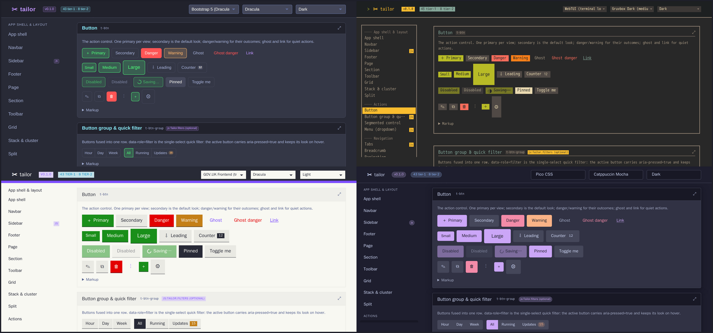

# tailor

**One component vocabulary, swappable skins, canonical palettes** — a design system for plain HTML.



*Same markup, four skins. Full page: [docs/showcase-full.png](docs/showcase-full.png).*

Write your UI once, in semantic HTML with `t-*` classes and `data-*` attributes. Which design
system it looks like (Bootstrap, Pico, daisyUI, WebTUI, …) is a **skin** — one CSS file. Which
colours it wears is a **palette** — one generated CSS file. Both swap at runtime; the markup never
changes. No framework, no build step, no npm for consumers: plain CSS plus ~300 lines of vanilla
JS, 8 skins × 21 palettes, every combination verified for coverage and contrast, three adopted
icon sets delivered as a per-project SVG sprite, and a machine-readable `manifest.json` describing
the whole system.

```html
<button class="t-btn" data-variant="primary">Deploy</button>
<span class="t-badge" data-tone="success">running</span>
```

## Requirements

- [Bun](https://bun.sh) ≥ 1.1 — for the repository's own scripts (`bin/build`, `bin/verify`, `bin/tailor`) only.
- Consumers need nothing: the output is plain CSS and JS.
- Node/npm (or Bun) only if you use the React adapter in `react/`.
- `bun install` in `icons/` (Iconify JSON packages) to render icon sprites or regenerate the icon-set entries.

## Setup

```sh
git clone https://github.com/rojosinalma/tailor && cd tailor
(cd icons && bun install)        # icon data for the sprites (optional for the showcase alone)
bin/build                        # palettes/*.css, manifest.json, showcase/index.html + icons.svg
bunx serve .                     # or: python3 -m http.server
```

Open `/showcase/`: every component, with the skin/palette switcher and sun/moon toggle in the footer;
`?skin=pico&palette=nord&mode=dark` deep-links a combination. `bin/verify` runs the checks.

To use tailor in your own project, let `bin/tailor apply <project-dir>` vendor the core, every skin and every
palette (all 21 come in dark and light) into your static assets. Load order, the head snippet and
`Tailor.theme.init` are in [docs/usage.md](docs/usage.md); the CLI in [docs/cli.md](docs/cli.md);
icons in [docs/icons.md](docs/icons.md); the layering in [docs/architecture.md](docs/architecture.md).

## License

MIT — see [LICENSE](LICENSE). Palettes reuse colour values under their upstream licences; see
[docs/palette-licenses.md](docs/palette-licenses.md). Icon sprites carry icon data under each set's
licence (MIT, ISC, CC0-1.0); see [docs/icons.md](docs/icons.md).
